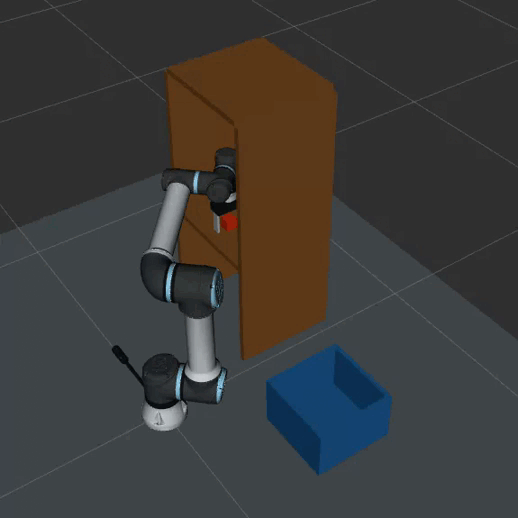

# arm-simulation

6-DOF arm simulation with ROS 2 Humble, Gazebo, MoveIt and RViz.

## Setup

Requires Miniforge/Miniconda with `conda` on `PATH`. Run from the workspace root:

```bash
./scripts/install_dependencies.sh  # Install dependencies in .conda/ and build
```

Run setup before the first launch and rerun after source changes or cleanup.
Keep the Conda environment separate from `/opt/ros`; use `ARM_CONDA_PREFIX`
to override `.conda/`.

## Run

Run from the workspace root after setup. These commands only launch the simulation:

```bash
./scripts/run_moveit.sh              # Open RViz with Gazebo physics in the background
./scripts/run_moveit.sh --pick-place # Open the shelf scene; start with the RViz button
```

Gazebo always runs without its GUI, providing physics and robot state in place of
real hardware. Use RViz to view and control the robot.

The robot starts at `home`. In RViz, drag the goal and use **Plan & Execute**.
With `--pick-place`, the scene waits for **Run Pick & Place** in the **Pick & Place**
panel. Set speed and acceleration (% of joint limits), approach/lift distances,
shelf withdrawal, transfer height and release clearance (mm) before starting.
Transfer height is the TCP's absolute height above the robot base. Settings start
from the demo YAML and apply to the next cycle; inputs are locked while running.
This mode shows the planning scene without the manual Motion Planning panel.
Click again after the cycle finishes to repeat. All scripts support `--help`.
Use **Stop** to interrupt planning or execution. The task requests motion
cancellation before exiting; settings unlock after it has stopped. A stopped
cycle leaves the scene for inspection; the next run resets the demo objects.

Placement succeeds only after fresh Gazebo feedback shows the entire rotated
payload inside the box with low linear/angular velocity for a continuous interval.
Thresholds are configured under `physics.placement_*` in the demo YAML.

Demo settings: [shelf_pick_place.yaml](src/arm_moveit_config/config/shelf_pick_place.yaml).



## Cleanup and tests

```bash
source scripts/install_dependencies.sh  # Load helpers only
arm_activate_conda
source install/setup.bash
python3 -m unittest discover -s tests -v
colcon test --packages-select arm_moveit_config --event-handlers console_direct+
colcon test-result --verbose
./scripts/clean_ws.sh  # Remove build/, install/, log/ and Python caches; keep .conda/
```

Integration tests require a disposable simulation with the same `ROS_DOMAIN_ID`.
Enable with `ARM_RUN_MOVEIT_TESTS=1`, `ARM_RUN_GAZEBO_TESTS=1`, or
`ARM_RUN_GAZEBO_GRASP_TESTS=1`; grasp tests need a session without `--pick-place`.

Planning-scene updates have a five-second wall-clock timeout. If a task exits
without acknowledgement, its scene lock remains marked as uncertain so that a
late update cannot corrupt the next task. An acknowledgement received before
exit clears this mark automatically. To recover after a lost service response,
stop all tasks and the simulation, clear the lock below, then relaunch:

```bash
: > "/tmp/arm_shelf_scene_$(id -u)_${ROS_DOMAIN_ID:-0}.lock"
```

Clear the contents only after stopping the simulation; keep the lock file itself
so that existing processes cannot use different lock inodes.
