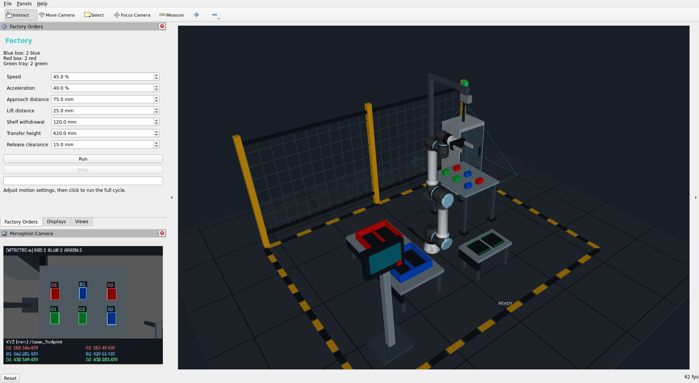

# arm-simulation

6-DOF arm simulation with ROS 2 Humble, Gazebo, MoveIt and RViz.

## Setup

Requires Miniforge/Miniconda with `conda` on `PATH`. Run from the workspace root:

```bash
./scripts/install_dependencies.sh
```

## Run

```bash
./scripts/run_moveit.sh              # Manual control in RViz
./scripts/run_moveit.sh --pick-place # Shelf-to-box pick-and-place
./scripts/run_moveit.sh --warehouse  # Factory color sorting
```

Use **Plan & Execute**, **Run Pick & Place**, or **Run** in RViz.
Use **Stop** to cancel a demo. Gazebo runs in the background.

Demo settings: [pick-and-place](src/arm_moveit_config/config/shelf_pick_place.yaml)
and [warehouse](src/arm_moveit_config/config/warehouse.yaml).



## Tests

```bash
source scripts/install_dependencies.sh
arm_activate_conda
source install/setup.bash
colcon test --packages-select arm_moveit_config
colcon test-result --verbose
```

## Cleanup

```bash
./scripts/clean_ws.sh  # Keep .conda/
./scripts/clean_ws.sh --stop-only  # Stop the simulation; keep the current build
```

Cleanup first stops this workspace's ROS, Gazebo and RViz processes, including
suspended terminal jobs, then removes `build/`, `install/`, and `log/`. It waits
for shutdown and forces any remaining processes to exit before deleting files.
Before launching again, run
`./scripts/install_dependencies.sh` to rebuild the workspace. Execute this script
directly; sourcing it only loads helper functions and does not install or build.
