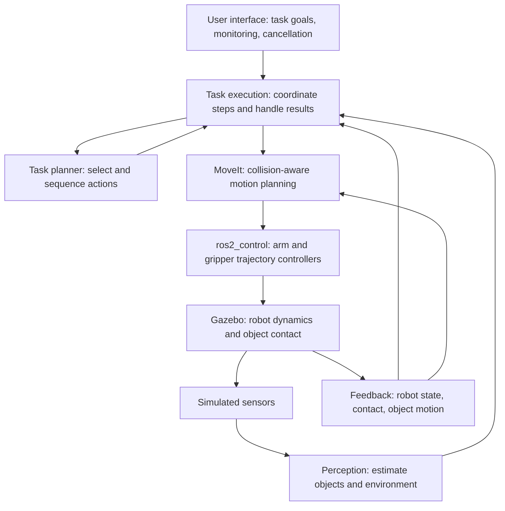

# System Architecture

A ROS 2 simulation architecture for a 6-DOF robot arm, connecting perception, task planning, motion planning, and feedback control. Current applications include pick-and-place and warehouse order fulfillment.

## Main Flow

The task planner decides **what to do and in which order**. MoveIt plans **how the robot should move**, and the controllers track the resulting trajectories. Feedback lets task execution verify each step and decide whether to continue, replan, or stop. The diagram shows logical responsibilities; several are implemented within the same package.

## Packages

| Package | Responsibility |
| --- | --- |
| `arm_description` | Robot model, UR7e visual meshes, collision geometry, joint limits, inertia, and tool frames. |
| `arm_bringup` | Launch Gazebo, spawn the robot, and start simulation components. |
| `arm_perception` | Detect colored objects from RGB-D images and transform their positions into the robot frame. |
| `arm_moveit_config` | Configure MoveIt, maintain the planning scene, implement application-specific task planning and execution, and provide RViz controls. |
| `arm_control` | Configure effort-based trajectory controllers and provide trajectory utilities. |
| `arm_task_interfaces` | Define the pick-and-place action with goals, progress feedback, and results. |

## Task Workflow

1. Receive a task goal and observe the environment.
2. Select a sequence of actions based on the goal and current state.
3. Plan collision-aware trajectories for the required movements.
4. Execute arm and gripper commands through the controllers.
5. Monitor feedback and verify the result of each action.
6. Update the state and continue, replan, or stop according to the result.

Task rules and verification conditions depend on the application. For example, the current warehouse task selects stock moves and buffer use, while pick-and-place coordinates approach, grasp, transfer, and release. Perception currently detects colored objects from simulated RGB-D images.

## Simulation Boundaries

- **Gazebo** simulates gravity, joint dynamics, friction, and physical grasping. Objects remain free bodies during transport.
- **MoveIt** represents obstacles and the carried object for collision checking. Its object attachment does not physically attach the object in Gazebo.
- **Feedback** supports motion monitoring, fault detection, and task cancellation.
- **Model fidelity:** visual meshes follow the real robot shape; collision geometry and inertia are simplified. The hardware interface currently targets Gazebo.

## Validation

The `tests/` directory contains unit and integration tests for the robot model, perception, planning, trajectories, task actions, and physical pick-and-place. Integration tests require the corresponding simulation session and explicit enable flags.
